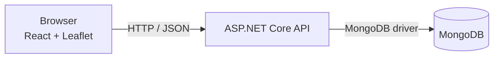

# Architecture

## System overview

In the Docker Compose deployment, Nginx serves the compiled client, the API is
available on host port `5260`, and MongoDB is available only to the Compose
network unless separately configured.

## Client

The client is a single-page React application:

- **Leaflet and React Leaflet** render the base map, saved geometries, and
  in-progress drafts.
- **Zustand** stores transient interaction state: the active tool, draft
  polygon/object, and current selection.
- **TanStack Query** owns fetched server data and mutations. Successful writes
  invalidate the matching query so the feature list is refreshed from the API.
- **`src/services/api.ts`** centralizes HTTP requests, JSON headers, and
  `ApiError` handling.

The UI currently supports listing, creating, selecting, and deleting polygons
and point objects. The API supports updates, but the client has no update
controls or update API functions yet.

## Server

The API is organized around controllers, services, and MongoDB-backed entities:

1. Controllers in `Controllers/` implement REST endpoints and validate incoming
   geometry with `GeoJsonGeometryParser`.
2. Services in `Services/` query and mutate the corresponding MongoDB
   collections.
3. `PolygonEntity` and `MapObjectEntity` represent persisted data.
   `GeoJsonGeometry` stores the GeoJSON type and coordinates.
4. `JsonElementBsonSerializer` serializes JSON coordinates as BSON arrays and
   values rather than an empty document.
5. On service initialization, the API creates a 2dsphere index on each
   collection's `Geometry` field.

The API uses ASP.NET Core's JSON defaults for HTTP payloads and the MongoDB
driver for persistence. MongoDB collection data uses lowercase GeoJSON members
`type` and `coordinates`; API JSON uses the ASP.NET Core configured
camel-casing.

## Data flow

1. A user selects a drawing/placement tool and interacts with the map.
2. Client state retains the draft until the user saves or discards it.
3. The client sends a JSON request to `/api/polygons` or `/api/objects`.
4. The API validates the geometry structure and stores the entity in MongoDB.
5. TanStack Query refreshes the corresponding collection; Leaflet and the data
   table render the saved record.

## Spatial data

Coordinates use GeoJSON's longitude-first ordering and WGS 84 / EPSG:4326:

- Point: `[longitude, latitude]`
- Polygon: `[[[longitude, latitude], ...]]` (an array of linear rings)

Polygon rings must contain at least four positions and be closed: the first and
last positions must have equal longitude and latitude. Each position must
contain exactly two numeric values. Point coordinates must contain exactly two
numeric values. The API parser does not enforce geographic coordinate bounds
or polygon winding order.

## Persistence

MongoDB stores polygons in the `polygons` collection and point objects in the
`objects` collection by default. Names and collection names can be changed with
the server configuration keys documented in the
[development guide](development.md#server-configuration).

The API creates 2dsphere indexes for geospatial queries. Compose persists its
MongoDB data in a named volume called `mongodb-data`.

## Operational boundaries

- The API CORS policy currently allows HTTP and HTTPS origins on loopback
  addresses, regardless of port. This is intended for local development; a
  deployed environment should use a narrowly scoped origin allowlist.
- The application has no authentication or authorization layer. Do not expose
  it publicly with sensitive data without adding appropriate access controls.
- The browser client requires an API URL reachable from the user's browser.
  Container-internal hostnames such as `server` are not usable as the browser's
  API address.
